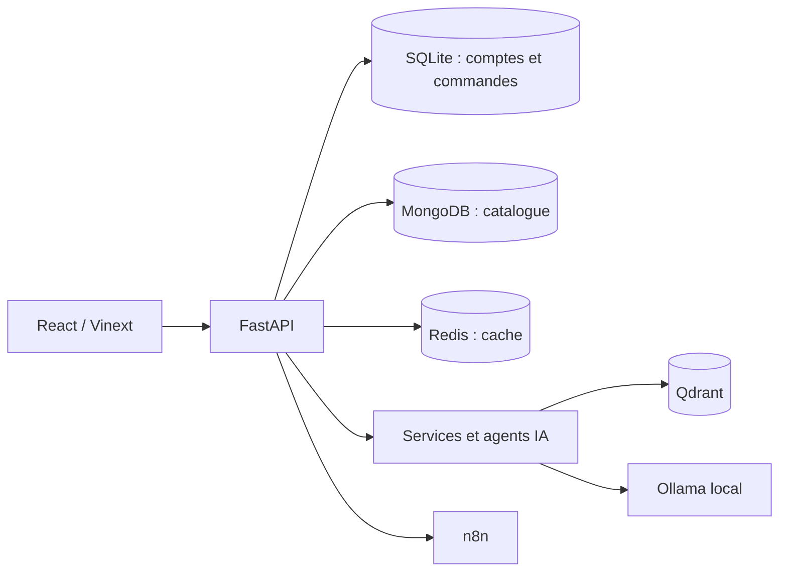

# NUTRIFIT · E-commerce & agents IA

Une plateforme de nutrition sportive qui relie le parcours d'achat à des outils d'aide à la décision : recherche sémantique, recommandations, assistance client et supervision des opérations.

**FastAPI · React / Vinext · MongoDB · SQLite · Redis · Qdrant · Ollama · Docker**

## Ce que montre le projet

- **Parcours client :** catalogue, filtres, panier invité ou connecté, commande et paiement à la livraison.
- **Back-office :** produits et médias, stock, commandes, tickets support, rôles et authentification JWT.
- **IA appliquée :** recherche vectorielle, recommandations, brouillons de contenu et SEO, assistance et analyses de ventes.
- **Automatisation :** orchestration des agents, propositions de réapprovisionnement et workflows n8n.
- **Contrôle humain :** validation des propositions avant modification ou publication ; les agents de suivi ne confirment pas les commandes à la place de l'équipe.

## Architecture



## Démarrage local

Prérequis : Git et Docker Desktop avec Docker Compose. Les modèles Ollama nécessitent de la mémoire et de l'espace disque supplémentaires.

```powershell
git clone https://github.com/lahlouabdeslam6-rgb/Ecommerce-AI.git
cd Ecommerce-AI
Copy-Item .env.example .env
# Remplacer les valeurs de démonstration dans .env avant le démarrage.
docker compose up -d --build
docker compose exec ollama ollama pull qwen2.5:3b
docker compose exec ollama ollama pull nomic-embed-text
```

| Service | Adresse locale par défaut |
| --- | --- |
| Boutique | http://localhost:5173 |
| Documentation API | http://localhost:8000/docs |
| Santé API | http://localhost:8000/health |
| Automatisation | http://localhost:5678 |

La première construction et le téléchargement des modèles peuvent prendre plusieurs minutes. Les étapes d'initialisation et d'administration sont décrites dans les [notes techniques](docs/implementation-notes.md).

## Repères dans le code

| Dossier | Rôle |
| --- | --- |
| `backend/app/` | API, schémas, services métier, agents et accès aux données |
| `frontend/` | Interfaces boutique, client, support et administration |
| `docker/` | Configuration des services et des workflows |
| `scripts/` | Outils d'initialisation et d'exploitation |
| `docs/` | Configuration et déploiement |

## Vérification

```powershell
docker compose run --rm --no-deps backend pytest -q
```

Cette commande lance la suite backend ; certains scénarios nécessitent les services locaux. Les consignes de déploiement sont dans [PRODUCTION.md](docs/PRODUCTION.md).

## État et limites

Projet de développement et de démonstration. Le paiement carte n'est pas relié à un prestataire réel. Les envois email et WhatsApp nécessitent les accès du fournisseur ; ils ne sont pas activés par le simple clonage. Les réponses des modèles et les prévisions doivent être évaluées avant utilisation métier.

Le fichier `suppdb_sample.csv` est un référentiel de produits et d'ingrédients, pas un export de clients. Les secrets et bases d'exploitation ne sont pas fournis.

**Auteur : [Ismail Lahlou](https://github.com/lahlouabdeslam6-rgb)** · [Portfolio](https://portfolio-ismail-lahlou.alvarezvcarlosr44274.chatgpt.site/)
